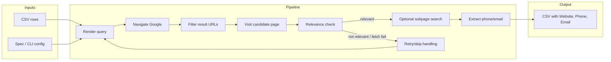

# HumanizedSeleniumScraper

> ## ⚠️ Educational demonstration only
>
> This project is a **teaching example** of browser automation and HTML parsing.
> **Automating Google Search violates Google's Terms of Service, and bypassing
> anti-bot or other security mechanisms is prohibited.** Do not use this project
> to scrape Google or any site against its terms. Use it only with data and sites
> you are authorised to access. See [`DISCLAIMER.md`](DISCLAIMER.md).

> **Archived -- This project is no longer maintained.**
> It was archived on 2026-02-12 and released as-is. No bug fixes, security patches, or new features will be added.
> If you need active development, see the [Alternatives & Successors](#alternatives--successors) section below.

A small, **dataset-agnostic** demonstration scraper. You bring any CSV dataset and
tell the tool which columns to use; for each row it searches, visits the most
relevant result, and writes the website, phone, and email it finds back to a new
CSV. Nothing about the input schema is hard-coded: with the default `generic`
preset the search query is built from every value in the row, and you can override
that with a template (or the `contact` preset) whenever you want.

Under the hood it drives a real Chrome browser with human-like typing, pauses, and scrolling to reduce the chance of being blocked.

## Features

- Dataset-agnostic: any CSV columns, with a template that maps them to a query
- Human-like typing, pauses, and scrolling
- Cookie banner handling with fallback selectors
- URL filtering (TLD allowlist, domain keyword blacklist, query-part matching)
- Relevance scoring with keywords and optional address matching
- Subpage search on the same domain
- Phone and email extraction (including basic obfuscation patterns)
- Retry logic with skip-on-repeated-failure
- Incremental CSV output (header written once, rows appended)

## How it works



The scraper processes one input row at a time and keeps browser behavior intentionally human-like (typing, pauses, and scrolling). Result URLs are filtered, and a candidate page — or a relevant same-domain subpage up to `subpage_depth` — must pass the relevance check before extraction. Failed page loads are retried; a candidate that still fails is skipped so the next result can be tried, while an unreachable Google page skips the row and the run proceeds to the next one.

## Lifecycle

```mermaid
sequenceDiagram
  participant CLI
  participant Run
  participant Session
  participant Driver
  participant Google
  participant Page

  CLI->>Run: main then run_batch(input_file, output_file, config, spec)
  Run->>Session: Session.create(config, profile_dir)
  Session->>Driver: create_driver(config, profile_dir)
  Run->>Run: Read CSV header / columns

  loop For each CSV row
    Run->>Run: render_template(query_template, row)
    Run->>Session: session.search(query, row, spec)
    Session->>Session: maybe_restart_driver()
    Session->>Driver: safe_get(google_url)
    Driver->>Google: Navigate to Google
    Session->>Driver: click_cookie_consent_if_present()
    Session->>Driver: human_type(search_box, query) ; submit
    Session->>Driver: Wait results ; get links
    alt Link passes url_filter (is_relevant_url)
      Session->>Driver: safe_get(href)
      Driver->>Page: Visit candidate
      Session->>Session: find_relevant_page() (landing, then subpages)
      Session->>Driver: parse_phone_email_deep()
      Session-->>Run: target_url, phone, email
    else Skip or retry
      Session-->>Run: None, None, None or SkipEntryError
      Run->>Run: log reason and continue
    end
    Run->>Run: CsvResultWriter.write_row(row_out)
  end

  Run->>Session: session.close()
  Session->>Driver: driver.quit()
```

Each run starts from CLI config and creates one reusable Selenium session. For every CSV row, the scraper builds a query, executes search, evaluates candidates, and writes exactly one output row. Failure paths are explicit: rejected or unreachable candidates are skipped so the next result can be tried, an unreachable Google page skips the row (`SkipEntryError`), and every path still produces exactly one output row without terminating the batch.

## Requirements

- Python 3.12+
- Chrome/Chromium installed (Selenium Manager will fetch a compatible driver at runtime)
- Network access (Google + target sites)

## Installation

```bash
python -m venv .venv
source .venv/bin/activate  # Linux/macOS
# Windows: .venv\Scripts\activate

python -m pip install .
```

## Quickstart

### 1. Choose a dataset

You provide the data. Any CSV works -- it does not have to be company addresses.
For example, a `dataset.csv` with a header row:

```
topic,region
electric cars,Norway
solar panels,Spain
```

or a set of business rows:

```
name,street,plz,city
Acme GmbH,Hauptstr. 1,10115,Berlin
Widget Corp,Marienplatz 5,80331,Munich
```

A header row is **recommended**: the scraper then takes the column names from the
file. Without a header you must name the columns yourself with `--columns`
(for example `--columns topic,region`).

### 2. Run the scraper

With a header row:

```bash
python -m humanized_selenium_scraper --header --dataset dataset.csv --output output.csv
```

Without a header (name the columns explicitly):

```bash
python -m humanized_selenium_scraper --dataset dataset.csv --columns topic,region --output output.csv
```

`--input` is accepted as an alias for `--dataset`, so older commands keep working.

By default the scraper uses the **`generic`** preset: the query for each row is
every value in that row joined together, and a page is relevant when it mentions
any word from that query. A Chrome window will open and begin searching; results
are written to `output.csv` as they are found.

### 3. Other examples

The **`contact`** preset restores the address-aware behaviour: it builds queries
from `name`/`street`/`plz`/`city` and checks the page for a matching address:

```bash
python -m humanized_selenium_scraper --preset contact --header --dataset companies.csv
```

Use the **`keywords`** preset when your CSV has `query` and `keyword` columns:

```bash
python -m humanized_selenium_scraper --preset keywords --columns query,keyword --dataset input.csv
```

Use a **TOML spec file** for full control over search, filtering, and relevance settings (see `example_search_spec.toml`):

```bash
python -m humanized_selenium_scraper --spec example_search_spec.toml --header --dataset input.csv
```

Show all available options:

```bash
python -m humanized_selenium_scraper --help
```

## Configuration

Settings can be provided via CLI flags, a TOML spec file, or both. CLI flags override values from the spec file.

### Common CLI flags

| Flag | What it does | Example |
|------|-------------|---------|
| `--dataset` / `--input` | Choose the dataset (CSV) to process (default: `input.csv`) | `--dataset companies.csv` |
| `--header` | Treat the first CSV row as column names | `--header` |
| `--columns` | Column names for a headerless CSV (required without `--header`) | `--columns topic,region` |
| `--delimiter` | CSV field delimiter (default: `,`) | `--delimiter ';'` |
| `--preset` | Built-in preset: `generic` (default), `contact`, or `keywords` | `--preset contact` |
| `--google-domain` | Google country domain to search | `--google-domain google.de` |
| `--query-template` | Python format string that builds the search query from CSV columns | `--query-template '{name} {city} kontakt'` |
| `--keyword-template` | Word(s) the page must contain to be considered relevant (repeatable) | `--keyword-template '{name}' --keyword-template 'contact'` |
| `--require-address` | Only accept pages that also mention the street/zip/city | `--require-address` |
| `--no-require-address` | Accept pages based on keywords alone (no address check) | `--no-require-address` |
| `--no-phone` / `--no-email` | Skip phone or email extraction | `--no-phone` |
| `--no-notice` | Suppress the educational-use notice printed at startup | `--no-notice` |
| `--verbose` / `-v` | Print detailed debug output | `-v` |
| `--log-file` | Where to write the log (default: `scraper.log`) | `--log-file run1.log` |
| `--version` | Print version and exit | `--version` |

### Datasets and presets

The input schema is yours. A **preset** is just a starting `SearchSpec`; you can
always refine it with the flags above or a TOML file.

| Preset | Query built from | Relevance | Use when |
|--------|------------------|-----------|----------|
| `generic` (default) | Every value in the row (or your `--query-template`) | Page must mention a word from the query | Any dataset; you are not scraping addresses |
| `contact` | `{name} {street} {plz} {city}` | Keywords plus an optional address match | Business/contact lookups |
| `keywords` | `{query}` | A page must contain the `keyword` column value | Keyword-driven searches |

`{__row__}` is a special placeholder that expands to all values in the row, which
is what makes the `generic` preset work with any CSV. You can mix it with other
columns, e.g. `--query-template '{__row__} contact'`.

### TOML spec file

For full control, create a TOML file (copy `example_search_spec.toml` as a starting point) and pass it with `--spec`:

| Section | Controls |
|---------|----------|
| `[selenium]` | Google domain, browser restart frequency, retry count |
| `[search]` | Query template, phone/email extraction toggles |
| `[relevance]` | Keyword templates, hit thresholds, address matching |
| `[url_filter]` | Accepted TLDs, blacklisted domains, domain-matching mode |
| `[navigation]` | How many Google results to scan, links per page, subpage depth |

See `example_search_spec.toml` for a fully commented example.

## Output

The output CSV contains every column from your input plus three new columns: `Website`, `Phone`, and `Email`. Rows that could not be matched are still written (with empty values for the new columns) so you can see what was skipped.

The file is written incrementally -- one row at a time -- so you can monitor progress or safely interrupt a long run.

**Example** (input has columns `name`, `city`; output adds the three contact columns):

```
name,city,Website,Phone,Email
Acme GmbH,Berlin,https://www.acme-berlin.de,+49 30 1234567,info@acme-berlin.de
Widget Corp,Munich,,,
Foo AG,Hamburg,https://foo-ag.de/kontakt,+49 40 9876543,kontakt@foo-ag.de
```

In this example, Widget Corp had no relevant result -- the row is preserved with empty contact fields.

> **Note:** cells that begin with `=`, `+`, `-`, `@`, a tab, or a carriage return
> are prefixed with an apostrophe to stop spreadsheets from treating them as
> formulas (CSV injection). A phone number such as `+49 30 1234567` is therefore
> written as `'+49 30 1234567` in the file. Spreadsheets display it without the
> apostrophe.

## Logging & Privacy

- Logs are written to the file given by `--log-file` (default: `scraper.log`) and also to stderr. Use `--verbose` or `-v` for debug logging.
- Query contents are redacted in logs (length and token count only).
- Output data may include phone/email; handle it according to your privacy requirements.

## Security

For responsible disclosure see `SECURITY.md`.

## Troubleshooting

- Driver issues: ensure Chrome/Chromium is installed and on PATH. If Selenium Manager fails, install a compatible ChromeDriver and add it to PATH.
- Captchas/throttling: increase delays, reduce query volume, and keep concurrency low.
- Cookie banners: update selectors in `click_cookie_consent_if_present()` if needed, including iframe handling.
- Element not interactable: use waits and the robust click helper (`click_element_robust`).
- Timeouts: increase page load timeout or reduce subpage depth/links per page.

## Alternatives & Successors

> This project is archived. Consider these actively maintained alternatives:

| Project | Description | Link |
|---------|-------------|------|
| SerpAPI | Managed Google search API, no browser needed | [serpapi.com](https://serpapi.com) |
| Playwright + stealth | Modern browser automation with anti-detection | [playwright.dev](https://playwright.dev) |
| Apify | Cloud scraping platform with Google search actors | [apify.com](https://apify.com) |
| ScraperAPI | Proxy-based search scraping service | [scraperapi.com](https://scraperapi.com) |

## Disclaimer

**This project is an educational demonstration of browser automation and must not
be used to scrape Google or to bypass security mechanisms.**

Automating Google Search violates Google's Terms of Service, and bypassing
anti-bot, CAPTCHA, rate-limiting, or other security controls is prohibited and may
be unlawful. Use this project only on data and sites you own or are explicitly
authorised to access and only where their terms permit automated access. You are
solely responsible for your use of this code and for complying with all applicable
terms and laws.

See [`DISCLAIMER.md`](DISCLAIMER.md) for the full statement. If you need data at
scale, use an official API such as the Google Custom Search JSON API, or a licensed
data provider.

## License

See `LICENSE`.
